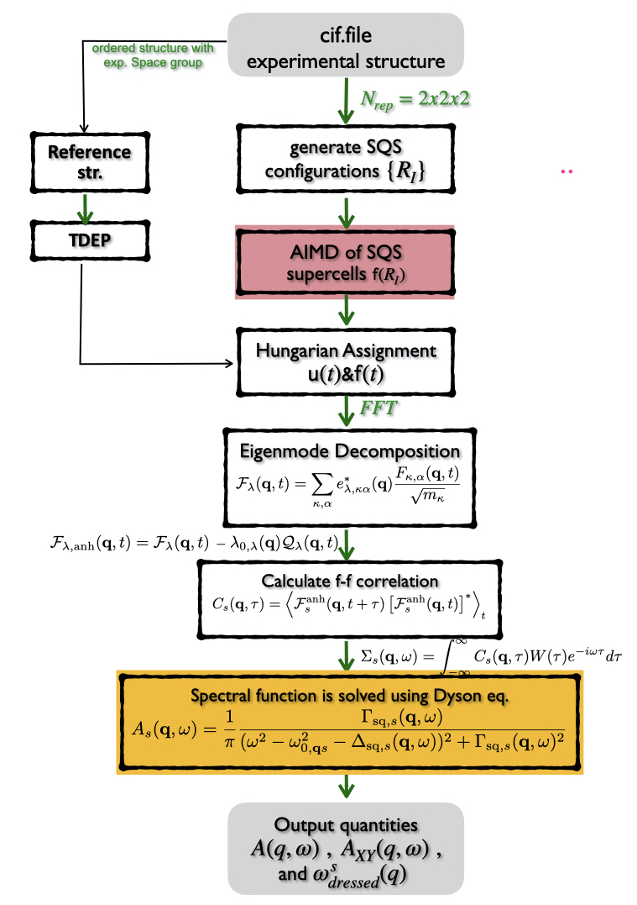

# CADLD — Configuration-Averaged Dynamical Lattice Dynamics

**Phonon spectral functions of superionic and partially disordered crystals from MD trajectories**

CADLD computes temperature-dependent, anharmonic phonon spectral functions $A(\mathbf{q},\omega)$ for materials where standard lattice dynamics fails: mobile-ion (superionic) conductors, vacancy-disordered sublattices, and mixed-occupancy sites. It projects a molecular dynamics trajectory (AIMD or MLMD, e.g. on an SQS supercell) onto the harmonic phonon eigenvector basis of an **ordered reference structure**. From the projected force–force correlations it builds a **phonon self-energy** and solves the **Dyson equation** for the dressed phonon Green's function.



---

## ✨ Features

- **Trajectory-to-lattice mapping** with the Hungarian algorithm (`scipy.optimize.linear_sum_assignment`). It works under periodic boundary conditions, checks sublattice compatibility (cation ↔ cation, anion ↔ anion), and uses a distance cutoff.
- **Natural vacancy handling.** An unassigned (vacant) site contributes zero displacement and zero force, so vacancy disorder is encoded directly in the correlation functions.
- **Normal-mode projection** onto TDEP second-order force constants (`outfile.forceconstant`), using mass-weighted eigenvectors $\vec{e}_{s,\kappa}(\mathbf{q})$.
- **Anharmonic force extraction:** $\mathcal{F}^{\text{anh}}_s(\mathbf{q},t) = \mathcal{F}_s(\mathbf{q},t) + \omega_s^2(\mathbf{q})\,\mathcal{U}_s(\mathbf{q},t)$, i.e. the effective harmonic restoring force is subtracted.
- **Phonon self-energy** $\Sigma_s(\mathbf{q},\omega)$ from the Fourier-transformed force autocorrelation, with Gaussian damping.
- **Dyson-equation spectral function** $A(\mathbf{q},\omega)$ along any high-symmetry path.
- **Partial projections** by species (`--select-species "Ag"`) or by individual sites (`--select-sites`).
- **Self-energy scaling** (`--scale-self-energy`) to follow the path from harmonic to fully renormalized phonons.
- **Diagnostics:** MSD, harmonic vs. dressed dispersion, and spectral-function maps (linear or log scale).

---

## 🧮 Theory in brief

1. **Reference lattice** $\mathbf{R}_0$: an ordered, symmetry-preserving cell (for example $P\bar{6}$) whose harmonic eigenvectors define an orthonormal projection basis.
2. **Mapping:** at each timestep, MD atoms are assigned to reference sites, giving displacements $\mathbf{u}_\kappa(t)$ and forces $\mathbf{f}_\kappa(t)$.
3. **Projection:**
   $\mathcal{U}_s(\mathbf{q},t)=\sum_\kappa \sqrt{m_\kappa}\,\vec{e}^{\,*}_{s,\kappa}(\mathbf{q})\cdot\mathbf{u}_\kappa(\mathbf{q},t)$, and likewise for $\mathcal{F}_s$ using $1/\sqrt{m_\kappa}$.
4. **Self-energy:** $\Sigma_s(\mathbf{q},\omega) \propto \frac{1}{k_BT}\int dt\, e^{i\omega t}\,\langle \mathcal{F}^{\text{anh}}_s(\mathbf{q},t)\,\mathcal{F}^{\text{anh}*}_s(\mathbf{q},0)\rangle$
5. **Dyson equation:**
   $A_s(\mathbf{q},\omega) = -\frac{1}{\pi}\,\mathrm{Im}\,\dfrac{2\omega_s}{\omega^2-\omega_s^2-2\omega_s\Sigma_s(\mathbf{q},\omega)}$

The full derivation is in the accompanying manuscript (see [Citation](#-citation)).

---

## 📦 Installation

```bash
git clone https://github.com/<your-username>/CADLD.git
cd CADLD
pip install numpy scipy matplotlib
```

Requires Python ≥ 3.8. No compilation is needed.

---

## 🚀 Quick start

### Required inputs

| File | Description |
|------|-------------|
| `POSCAR` | Ordered reference unit cell (e.g. relaxed at 0 K) |
| `vasprun.xml` | MD trajectory (positions + forces), AIMD or MLMD |
| `outfile.forceconstant` | TDEP 2nd-order IFCs for the reference cell |

### 1. Spectral function with self-energy correction

```bash
python phonon_self_energy.py \
    --poscar POSCAR \
    --vasprun vasprun.xml \
    --forceconstants outfile.forceconstant \
    --temp 300 \
    --qpath "0,0,0 0.5,0,0 0.333,0.333,0 0,0,0" \
    --labels "Gamma M K Gamma" \
    --npoints 30 \
    --damping 500 \
    --out-dir output
```

### 2. Species-resolved projection (e.g. Ag sublattice only)

```bash
python phonon_self_energy.py --select-species "Ag" --out-dir output_Ag
```

### 3. Force-correlation analysis at selected q-points

```bash
python force_correlation.py --poscar POSCAR --vasprun vasprun.xml \
    --qpoints "0,0,0" --damping 500 --out-dir output_corr
```

### 4. Plotting

```bash
python plot_results.py --out-dir output --labels "Gamma M K Gamma" --log
```

---

## ⚙️ Main options (`phonon_self_energy.py`)

| Option | Default | Description |
|--------|---------|-------------|
| `--cutoff` | `1.5` | Mapping distance cutoff (Å) |
| `--temp` | `300` | Temperature (K) |
| `--qpath` / `--labels` | Γ–M–K–Γ | q-path boundaries (fractional) and labels |
| `--npoints` | `15` | q-points per segment |
| `--damping` | `500` | Gaussian damping time of correlations (fs) |
| `--max-lag-pct` | `50` | Max correlation lag (% of trajectory) |
| `--broadening` | `0.1` | Additional peak broadening (THz) |
| `--min-broadening` | `1.0` | Minimum broadening cap (cm⁻¹) |
| `--wgrid-points` | `2000` | Frequency grid points |
| `--scale-self-energy` | `1.0` | Self-energy scaling factor (0–1) |
| `--select-species` | – | Restrict projection to species |
| `--select-sites` | – | Restrict projection to 0-based site indices |
| `--no-compat` | off | Disable sublattice compatibility in mapping |

---

## 📂 Outputs

| File | Content |
|------|---------|
| `phonon_dispersion_harmonic.dat` | Bare TDEP dispersion along the path |
| `phonon_dispersion_dressed.dat` | Renormalized peak positions |
| `spectral_function_A_q_w.dat` | $A(\mathbf{q},\omega)$ on the q–ω grid |
| `MSD.dat` | Mean-squared displacement per species |
| `plot_*.png` | Figures generated by `plot_results.py` |

---

## 📁 Repository layout

```
CADLD/
├── phonon_self_energy.py   # Main driver: mapping → projection → Σ(q,ω) → Dyson → A(q,ω)
├── force_correlation.py    # Projected force–force correlation analysis
├── mapping_strategy.py     # Hungarian / PBC mapping utilities
├── plot_results.py         # Plotting of dispersions, A(q,ω), MSD
├── examples/               # Example inputs (e.g. Ag–Te–S argyrodite-like system)
└── docs/                   # Figures and methodology notes
```

---

## ⚠️ Notes and best practices

- **Choice of reference structure.** The ordered reference must be topologically compatible with the average lattice of the MD phase. Keep the space-group symmetry, even if that means a compromised stoichiometry, so that the eigenvector basis is well-conditioned. The correct spectral weights (mixed-occupancy sites, diffusing sublattices) come from projecting the disordered (SQS) dynamics onto this basis.
- **Trajectory length.** Use trajectories that are long compared with the ion-hopping timescale so that the correlation functions converge.
- **Without the self-energy** (`--scale-self-energy 0`), the peaks contain no anharmonic or disorder broadening and look like the ordered TDEP bands.

---

## 📖 Citation

If you use CADLD, please cite:

```bibtex
@article{CADLD,
  title   = {Configuration-Averaged Dynamical Lattice Dynamics for Superionic Conductors},
  author  = {<Authors>},
  journal = {<Journal>},
  year    = {2026}
}
```

Please also cite **TDEP** (Hellman *et al.*, PRB 84, 180301 (2011); PRB 87, 104111 (2013)) for the force constants.

---

## 📜 License

MIT License. See [LICENSE](LICENSE).

## 🤝 Contributing

Issues and pull requests are welcome. For major changes, please open an issue first to discuss what you would like to change.
